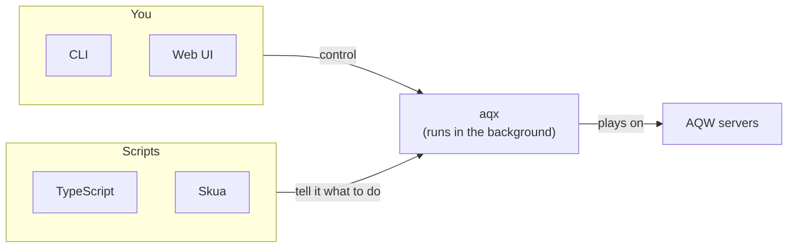

# aqx

aqx is a headless AQW client written in Rust. You run and script your accounts from a CLI or a web UI. Scripts are TypeScript files, and a compatibility layer runs most Skua scripts unchanged. Inspired by [aqw-python](https://github.com/Froztt13/aqw-python).

## Requirements

- [Rust](https://www.rust-lang.org/tools/install) 1.85 or newer
- [Node](https://nodejs.org/en/download) 24 or newer, to build the web UI
- The [.NET 10 SDK](https://dotnet.microsoft.com/download/dotnet/10.0), only to run Skua scripts

## Install

```sh
git clone https://github.com/toommyliu/aqx.git
cd aqx

# Build the web UI. cargo install embeds it in the aqx binary.
npm --prefix web ci
npm --prefix web run build

# Optional: fetch Skua to run Skua scripts.
git submodule update --init --depth 1 skua/vendor/Skua

cargo install --path crates/aqx

# Set up a scripts folder with aqx.toml, in ~/aqx by default.
aqx init

# Log in the accounts in aqx.toml and serve the web UI at http://127.0.0.1:4970.
aqx web --up
```

## Docs

- [Set up aqx and run sessions](docs/config.md)
- [Run accounts from the browser](docs/web.md)
- [Write an aqx script](docs/writing-scripts.md)
- [Run Skua scripts](docs/skua.md)

## How it works


